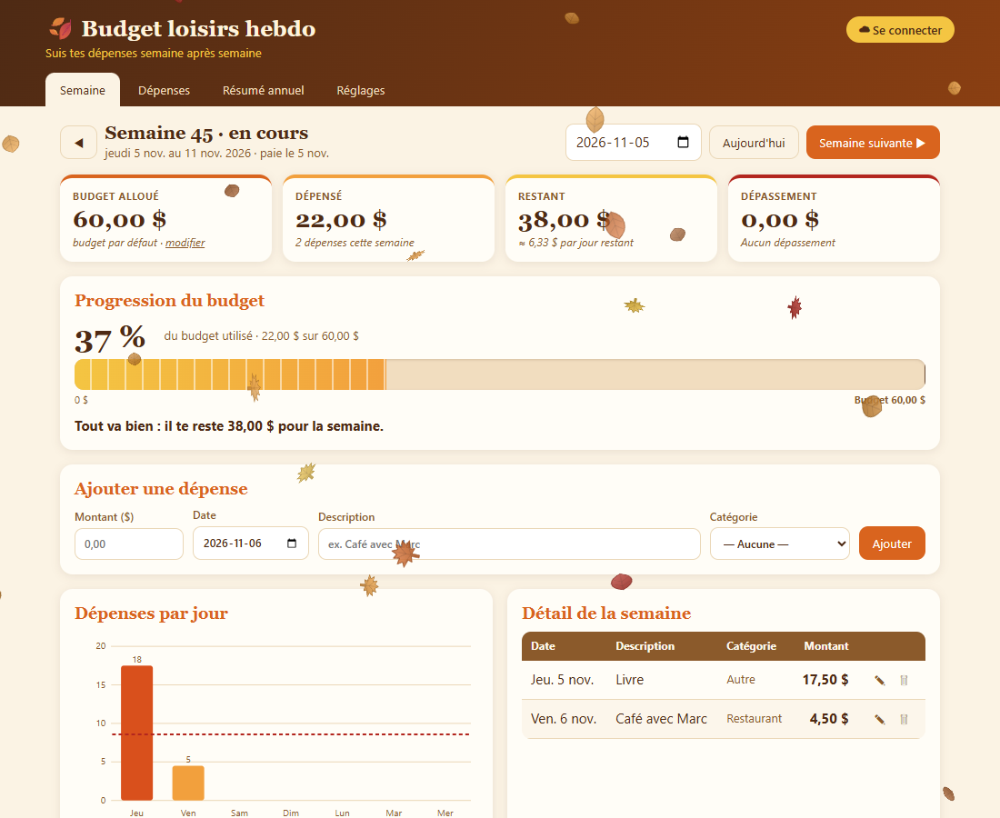
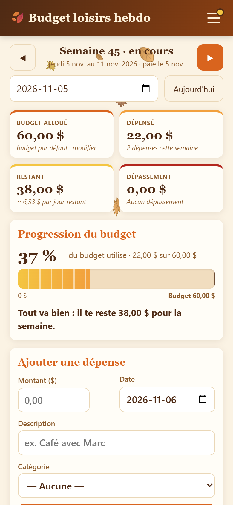

# 🍂 Budget loisirs hebdo

[](https://github.com/gourguesnicolas/budget-hebdo/actions/workflows/deploy.yml)

Suis ton budget loisirs **semaine après semaine**, d'une paie à l'autre, sur ordinateur comme sur téléphone.

**➜ [Ouvrir l'application](https://gourguesnicolas.github.io/budget-hebdo/)**

<p align="center">
  
  &nbsp;
  
</p>

## Fonctionnalités

- **Semaines de paie** : chaque semaine commence le jour où tu es payé (jeudi par défaut).
- **Suivi en un coup d'œil** : budget, dépensé, restant, dépassement et barre de progression.
- **Résumé annuel** : taux de réussite, séries, dépenses par mois et par catégorie.
- **Synchronisation** entre tes appareils (Firebase), avec fonctionnement **hors ligne**.
- **Thèmes saisonniers** (« 4 saisons » par défaut) et particules animées.
- **Tes données t'appartiennent** : export JSON / CSV (Excel) et import de sauvegarde.

Sans configuration Firebase, l'app fonctionne en **mode local** (données dans le navigateur).

## Démarrer

Prérequis : [Node.js](https://nodejs.org) 20.19 ou plus récent.

```bash
npm install
npm run dev        # http://localhost:5173
```

Pour activer la synchronisation, copie `.env.example` en `.env.local` et renseigne les paramètres de ton projet Firebase.

| Commande | Rôle |
|---|---|
| `npm run dev` | serveur de développement |
| `npm run build` | vérifie les types et construit dans `dist/` |
| `npm run test:engine` | tests du moteur de synchronisation |

## Déploiement

Chaque `git push` sur `main` publie le site sur GitHub Pages ([workflow](.github/workflows/deploy.yml)).

Le guide complet, de la création du projet Firebase au déploiement et à la sécurité, est dans **[LISEZ-MOI.md](LISEZ-MOI.md)**.

## Technologies

React 19 · TypeScript · Vite · Firebase (Authentication + Firestore) · GitHub Actions
